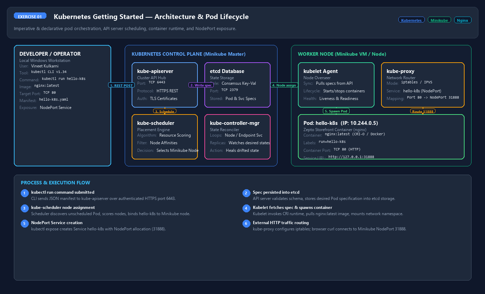
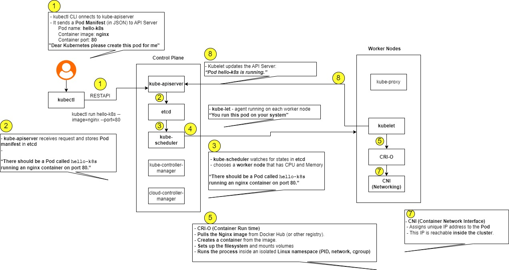
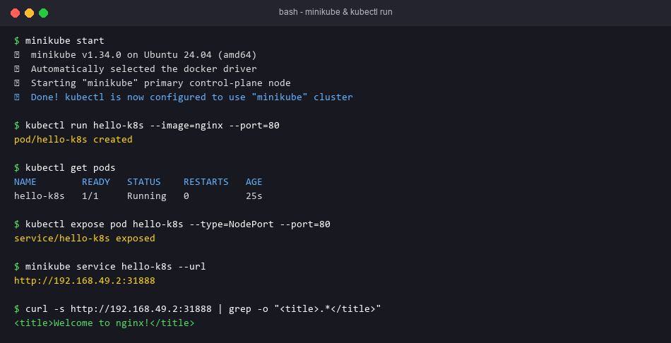

# Exercise 1 — Kubernetes Getting Started (Hello Pod)

## Objective
Run Zepto's "storefront" (simulated by `nginx`) as a Pod on Minikube, expose it with a NodePort Service, and open it in a browser.

## Technologies
Minikube, kubectl, Kubernetes Pod/Service, nginx image.

## Project Structure
| File | Purpose |
|---|---|
| `run.sh` | The lab-sheet imperative steps (`kubectl run` / `kubectl expose`) |
| `hello-k8s.yaml` | Declarative equivalent: Pod `hello-k8s` (label `run=hello-k8s`, port 80) + NodePort Service `hello-k8s` |

## Prerequisites
Minikube + a driver (Docker/Hyper-V/VirtualBox), kubectl.

## Commands
Imperative (as in the lab sheet):
```bash
minikube start
kubectl run hello-k8s --image=nginx --port=80
kubectl get pods
kubectl expose pod hello-k8s --type=NodePort --port=80
minikube service hello-k8s
```
Declarative alternative (use one or the other, not both):
```bash
kubectl apply -f hello-k8s.yaml
```

## Testing
```bash
kubectl get pods -o wide            # hello-k8s 1/1 Running
kubectl get svc hello-k8s           # TYPE NodePort, 80:3xxxx/TCP
kubectl get endpoints hello-k8s     # pod IP:80
kubectl logs hello-k8s
curl $(minikube service hello-k8s --url)   # HTML with <title>Welcome to nginx!</title>
```
Cleanup: `kubectl delete svc hello-k8s && kubectl delete pod hello-k8s`

## Expected Output
The nginx "Welcome to nginx!" page in the browser/curl.

## Actual Test Status
- YAML parsed; Service selector `run=hello-k8s` verified to match the Pod label and targetPort 80 matches containerPort (`validate_all.py`).
- `run.sh` passed `bash -n`.
- **Not deployed**: Minikube and Docker are not installed on this machine, and kubectl has no cluster context.

## Troubleshooting
- `ImagePullBackOff`: the node has no internet — `minikube ssh -- docker pull nginx`.
- `AlreadyExists`: delete the earlier pod/service before re-running.
- On the Docker driver for Windows/WSL, keep the `minikube service` terminal open (it runs a tunnel).

## Process Screenshots





