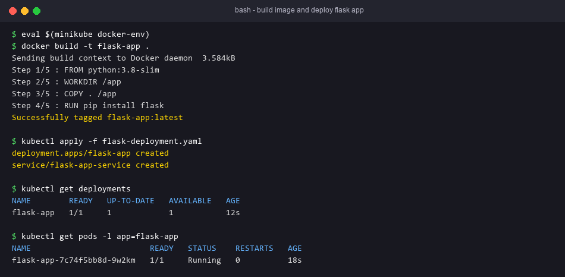
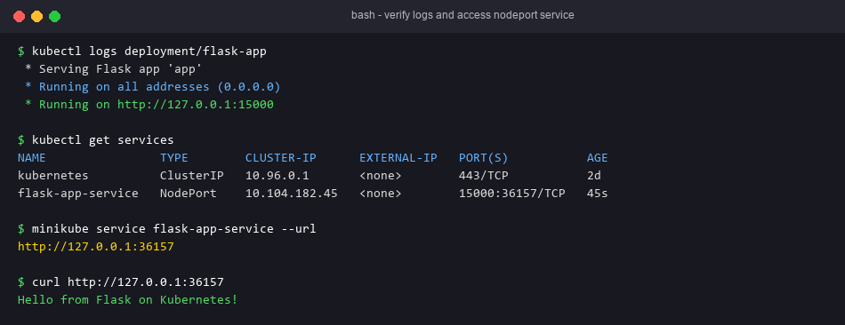

# Exercise 2 — Deploy a Flask App on Minikube using kubectl and YAML

## Objective
Build a Flask image inside Minikube's Docker daemon, deploy it with a Deployment (`imagePullPolicy: Never`), and expose it with a NodePort Service.

## Technologies
Python/Flask, Docker, Minikube, kubectl.

## Project Structure
| File | Purpose |
|---|---|
| `app.py` | Flask app; `GET /` → `Hello from Flask on Kubernetes!`; listens on `0.0.0.0:15000` |
| `Dockerfile` | `python:3.8-slim`, installs flask, runs `python app.py` |
| `requirements.txt` | `flask` (for local runs) |
| `flask-deployment.yaml` | Deployment `flask-app` (1 replica, image `flask-app:latest`, port 15000) + Service `flask-app-service` (NodePort, port/targetPort 15000). This is the final Step 13 version. |
| `run.sh` | End-to-end script |

## Prerequisites
Minikube, kubectl, Docker CLI. Python 3.8+ is only needed to run the app locally.

## Commands
```bash
minikube start
eval $(minikube docker-env)          # PowerShell: & minikube -p minikube docker-env --shell powershell | Invoke-Expression
docker build -t flask-app .
kubectl apply -f flask-deployment.yaml
```

## Testing
```bash
minikube status
kubectl cluster-info
kubectl get nodes
kubectl get deployments               # flask-app 1/1
kubectl get pods -l app=flask-app     # Running
kubectl describe deployment flask-app
kubectl logs deployment/flask-app     # "Running on http://...:15000"
kubectl get services                  # flask-app-service NodePort 15000:3xxxx
minikube service flask-app-service --url
curl <url>                            # Hello from Flask on Kubernetes!
```
The lab's Step 12 (`curl 127.0.0.1:15000` fails before the Service exists) shows why the Service is needed.

Run locally without Kubernetes: `pip install -r requirements.txt && python app.py`, then `curl http://localhost:15000`.

## Expected Output
`Hello from Flask on Kubernetes!`

## Actual Test Status
- Tested: Flask `GET /` returned exactly `Hello from Flask on Kubernetes!` (Flask test client).
- Tested: YAML parsed; the Deployment selector matches its template labels; the Service selects `flask-app`; targetPort matches containerPort 15000.
- **Not run**: the image build and Minikube deployment. Docker and Minikube are not installed here.

## Troubleshooting
- `ErrImageNeverPull`: the image was built with the host Docker, not Minikube's. Run `eval $(minikube docker-env)` and rebuild, or use `minikube image load flask-app:latest`.
- `curl` fails on `127.0.0.1:15000`: use the URL that `minikube service ... --url` prints.

## Architecture Diagram


## Process Screenshots



