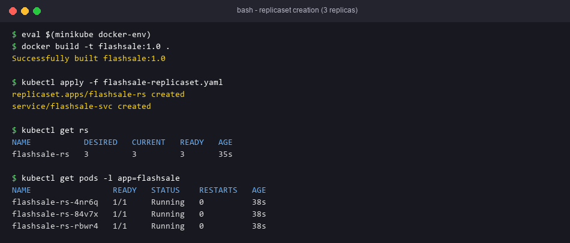
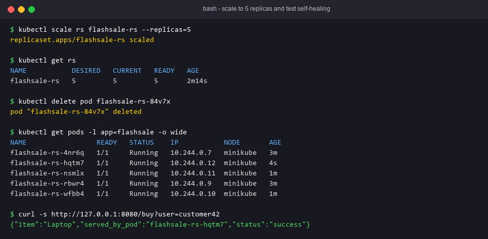

# Exercise 3 — Scaling a Flask App on a Single Node using ReplicaSets

## Objective
Run a "Flash Sale" Flask app as a ReplicaSet (3 → 5 replicas). Watch self-healing when a pod is deleted, and see which pod serves each request.

## Technologies
Python/Flask, gunicorn, Docker, Minikube, ReplicaSet, ClusterIP Service, readiness/liveness probes.

## Project Structure
| File | Purpose |
|---|---|
| `app.py` | `/` (welcome + pod name), `/buy?user=` (simulated checkout, `served_by_pod`), `/health` (probes) |
| `Dockerfile` | `python:3.11-slim`, gunicorn on `0.0.0.0:5000` |
| `flashsale-replicaset.yaml` | ReplicaSet `flashsale-rs` (replicas 3, selector/label `app=flashsale`, probes, resources) + Service `flashsale-svc` (80→5000) |
| `run.sh` | Full demo: start, build, apply, scale, delete pod, load test |

### Fixes to the reference
- The reference Dockerfile copies `ex3-flash-sale.py` but runs `app:app`, so gunicorn could not import it. The file is now `app.py`.
- Image tag: the manifest uses `flashsale:1.0`, but the reference builds `flask-app`. We build `flashsale:1.0` and set `imagePullPolicy: Never`.
- The reference commands use `flask-app-rs`, but the manifest's name is **`flashsale-rs`**. The commands below use the manifest's name.

## Prerequisites
Minikube, kubectl, Docker CLI.

## Commands
```bash
minikube stop; minikube delete
minikube start --nodes=1
kubectl get nodes
eval $(minikube docker-env)
docker build -t flashsale:1.0 .
kubectl apply -f flashsale-replicaset.yaml
```

## Testing
```bash
kubectl get rs flashsale-rs                       # DESIRED 3 CURRENT 3 READY 3
kubectl get pods -l app=flashsale                 # 3 pods
kubectl scale rs flashsale-rs --replicas=5
kubectl get rs flashsale-rs                       # 5/5/5
kubectl get pods -l app=flashsale                 # 5 pods
kubectl delete pod <one-pod>
kubectl get pods -l app=flashsale                 # still 5; one new pod
kubectl get pods -o wide                          # all on node "minikube"
kubectl get endpoints flashsale-svc               # 5 pod IPs on :5000
# Load distribution (from inside the cluster, so kube-proxy balances across pods):
kubectl run curl --rm -it --image=curlimages/curl --restart=Never -- \
  sh -c 'for i in $(seq 1 10); do curl -s flashsale-svc/buy; echo; done'
```

## Expected Output
- Q1 initial replicas: 3. Q2 pods after apply: 3.
- After scaling: 5 pods. After deleting one: the ReplicaSet recreates it (still 5).
- All pods run on the single node `minikube`. `served_by_pod` varies across requests.

## Actual Test Status
- Tested: `/`, `/buy?user=123` and `/health` returned the expected JSON (Flask test client).
- Tested: YAML parsed; ReplicaSet `matchLabels` `app=flashsale` equals the template labels; the Service selects the ReplicaSet's pods; targetPort 5000 matches the container port.
- **Not run**: building the image, applying the manifest, scaling and self-healing. Minikube and Docker are not available on this machine.

## Troubleshooting
- Pods `0/1 Running`: the readiness probe is failing. Check `kubectl logs` and `kubectl describe pod`.
- `ErrImageNeverPull`: the image was not built inside Minikube's Docker daemon.
- `kubectl port-forward` sticks to one pod. Use the in-cluster curl above to see load distribution.

## Architecture Diagram


## Process Screenshots



