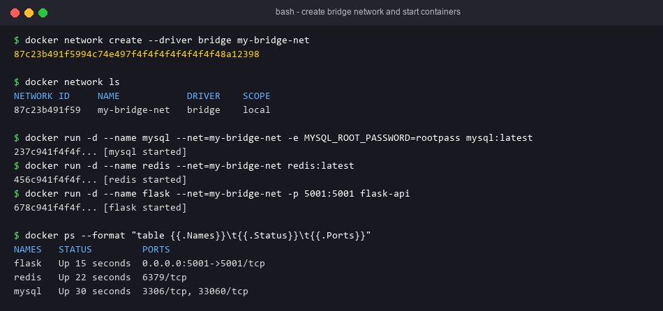
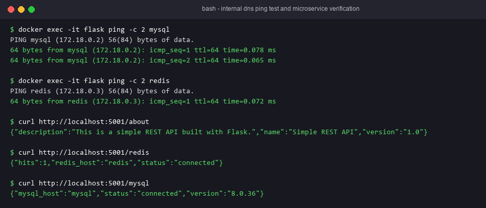

# Exercise 4 — Docker Networking with Multiple Containers

## Objective
Connect three containers (Flask API, MySQL, Redis) on a user-defined bridge network. They reach each other by container name through Docker's embedded DNS.

## Technologies
Docker, Docker bridge networks, Python/Flask, MySQL, Redis.

## Architecture
```
              host :5001
                  │  (-p 5001:5001)
┌─────────────── my-bridge-net (bridge, e.g. 172.18.0.0/16) ───────────────┐
│  flask (flask-api)  ──"mysql:3306"──►  mysql (mysql:latest)               │
│        │                                                                  │
│        └──────────"redis:6379"──►  redis (redis:latest)                   │
└───────────────────────────────────────────────────────────────────────────┘
```
Only Flask publishes a port. MySQL and Redis are reachable only from inside `my-bridge-net`.

## Project Structure
| File | Purpose |
|---|---|
| `app.py` | `GET /about` (lab sheet); `GET /redis` (INCR a counter in `redis`); `GET /mysql` (`SELECT VERSION()` on `mysql`) |
| `requirements.txt` | Flask 2.0.1 (+ Werkzeug 2.0.3, redis, PyMySQL, cryptography) |
| `Dockerfile` | `python:3.9-slim` + `iputils-ping`, EXPOSE 5001 |
| `run.sh` / `cleanup.sh` | Tasks 1–5 / Task 6 |

### Fixes to the reference
- `app.run(port=5001)` binds only to 127.0.0.1 inside the container, so `-p 5001:5001` would not work. Changed to `host='0.0.0.0'`.
- `mysql:latest` refuses to start without a root password. Added `-e MYSQL_ROOT_PASSWORD=rootpass`.
- `python:3.9-slim` has no `ping`. Installed `iputils-ping` for Task 5.
- Flask 2.0.1 breaks with Werkzeug ≥ 2.1. Pinned Werkzeug to 2.0.3.

## Prerequisites
Docker Engine / Docker Desktop.

## Commands
```bash
docker network create --driver bridge my-bridge-net
docker network ls
docker network inspect my-bridge-net
docker build -t flask-api .
docker run -d --name mysql --net=my-bridge-net -e MYSQL_ROOT_PASSWORD=rootpass mysql:latest
docker run -d --name redis --net=my-bridge-net redis:latest
docker run -d --name flask --net=my-bridge-net -p 5001:5001 flask-api
```
Or run `bash run.sh`.

## Testing
```bash
docker ps                                           # 3 containers Up
docker network inspect my-bridge-net                # Containers: flask, mysql, redis
docker exec -it flask ping -c 2 mysql               # resolves to 172.18.x.x
docker exec -it flask ping -c 2 redis
curl http://localhost:5001/about
curl http://localhost:5001/redis                    # {"status":"connected","hits":N}
curl http://localhost:5001/mysql                    # {"status":"connected","version":"9.x"} (wait ~20s for MySQL init)
docker logs flask; docker logs mysql
```
Cleanup: `bash cleanup.sh`

## Expected Output
- `ping` resolves the container names.
- `/about` returns the API JSON. `/redis` and `/mysql` report `connected`.

## Actual Test Status
- Tested: `/about` returned the exact JSON from the lab sheet (Flask test client).
- Tested: with no Docker network, `/redis` and `/mysql` return HTTP 503 JSON errors rather than crashing.
- Tested: `run.sh` and `cleanup.sh` passed `bash -n`.
- **Not run**: the network, the containers, ping, and the real Redis/MySQL connections. Docker is not installed on this machine.

## Troubleshooting
- `/mysql` returns 503 right after start: MySQL is still initialising. Wait, or watch `docker logs mysql`.
- `ping: not found`: rebuild the image (the Dockerfile installs iputils-ping).
- Name does not resolve: the container is on the default `bridge`. Embedded DNS works only on user-defined networks.
- Port 5001 is in use: change it to `-p 5002:5001`.

## Architecture Diagram


## Process Screenshots



