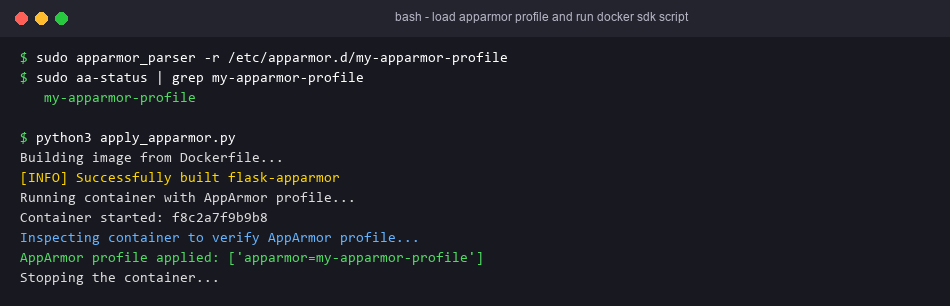
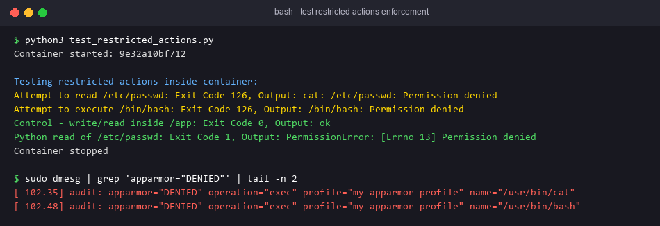

# Exercise 5 — Docker Security with AppArmor and Python

## Objective
Confine a containerised Flask app with an AppArmor profile. The profile denies reads of `/etc`, read/write of `/var`, execution of binaries in `/bin` and `/usr/bin`, and `CAP_SYS_ADMIN`. The profile is applied and verified through the Docker CLI and the Docker SDK for Python.

## Technologies
Docker, AppArmor (`apparmor_parser`), Python, Flask, Docker SDK for Python.

## Project Structure
| File | Purpose |
|---|---|
| `app.py` | Flask app on `0.0.0.0:5000` |
| `Dockerfile` | `python:3.8-slim`, image `flask-apparmor` |
| `my-apparmor-profile` | The AppArmor profile → `/etc/apparmor.d/my-apparmor-profile` |
| `apply_apparmor.py` | Task 4: build, run with `security_opt=["apparmor=my-apparmor-profile"]`, inspect `HostConfig.SecurityOpt` |
| `test_restricted_actions.py` | Task 5: `cat /etc/passwd` and `/bin/bash` (should be blocked), plus control checks |
| `requirements.txt` | `docker` SDK |
| `run.sh` | Complete run on an AppArmor-enabled Linux host |

### Profile notes (differences from the lab sheet)
- The lab sheet's header `/usr/bin/python3 { ... }` creates a profile named `/usr/bin/python3`. Docker looks profiles up by name, so `--security-opt apparmor=my-apparmor-profile` would fail with "profile not found". The profile is now declared as `profile my-apparmor-profile flags=(attach_disconnected,mediate_deleted)`.
- AppArmor denies anything not explicitly allowed. Python in this image lives in `/usr/local/bin`, so the profile adds the minimum allow rules it needs (`/usr/local/**`, libraries, `/tmp`, `/proc` read). All of the lab sheet's deny rules are kept. Deny rules always win over allow rules.
- Hardening rules were added in the style of docker-default (no mount, no writes to `/proc/sys/kernel`), plus signal rules so that `docker stop` still works.
- Debian images use a merged `/usr`, so `/bin/bash` resolves to `/usr/bin/bash`. The rule `deny /usr/bin/** rmix` blocks it.

## Prerequisites
A Linux host with AppArmor enabled (Ubuntu or Debian), Docker Engine, `apparmor-utils`, Python 3 and `pip install docker`.

## Commands
```bash
sudo apt-get install apparmor-utils
sudo cp my-apparmor-profile /etc/apparmor.d/my-apparmor-profile
sudo apparmor_parser -r /etc/apparmor.d/my-apparmor-profile
docker build -t flask-apparmor .
docker run --security-opt="apparmor=my-apparmor-profile" -p 5000:5000 flask-apparmor
pip install docker
python3 apply_apparmor.py
python3 test_restricted_actions.py
```
Or run `bash run.sh`.

## Testing
```bash
sudo aa-status | grep my-apparmor-profile              # listed in enforce mode
docker inspect -f '{{.AppArmorProfile}}' <container>   # my-apparmor-profile
curl http://localhost:5000                             # app still works
docker exec <c> cat /etc/passwd                        # blocked (non-zero exit; exec of /usr/bin/cat denied)
docker exec <c> /bin/bash                              # blocked, exit 126
sudo dmesg | grep 'apparmor="DENIED"'                  # kernel audit records
```

## Expected Output
```
AppArmor profile applied: ['apparmor=my-apparmor-profile']
Attempt to read /etc/passwd: Exit Code 126 (or 1), Output: ...permission denied
Attempt to execute /bin/bash: Exit Code 126, Output: ...permission denied
Control - write/read inside /app: Exit Code 0, Output: ok
Python read of /etc/passwd: Exit Code 1, Output: ...PermissionError...
```
The exit code for `cat` depends on whether the exec is denied (126) or the read is denied (1). With this profile, the exec of `/usr/bin/cat` is denied first.

## Actual Test Status
- Tested: the Flask route returned the expected text (Flask test client).
- Tested: `apply_apparmor.py` and `test_restricted_actions.py` compile.
- Tested: `run.sh` passed `bash -n`.
- **Not tested**: loading the profile and the blocking behaviour. This machine runs Windows; `wsl.exe` exists but has no Linux distribution installed, and Docker is not installed. `apparmor_parser` was not run, so profile syntax has not been checked by the parser, and **no denial has been observed**.

## Troubleshooting
- `profile "my-apparmor-profile" not found`: the profile was not loaded (`apparmor_parser -r`), or the host does not have AppArmor enabled (`aa-enabled`).
- The container exits at once with `permission denied` on Python: check `dmesg` for the denied path and add a narrow allow rule. Do not remove the deny rules.
- Docker Desktop on Windows or macOS does not support custom AppArmor profiles. Use a native Linux host or VM.

## Architecture Diagram


## Process Screenshots



