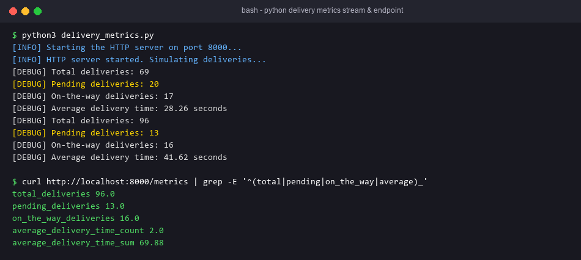
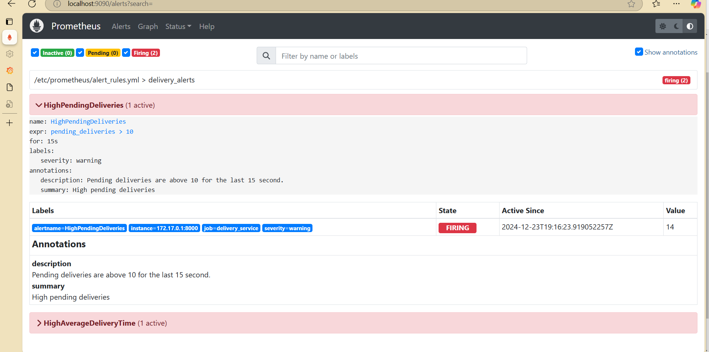
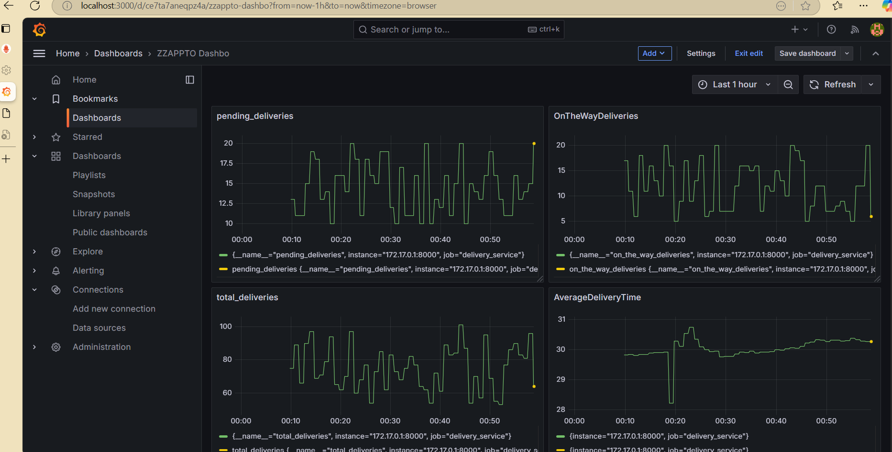

# Exercise 6 — Real-Time Monitoring of a Quick-Commerce App (Prometheus + Grafana + Jenkins)

## Objective
Simulate ZAPPTTO delivery metrics in Python and expose them on `/metrics`. Prometheus scrapes them and evaluates alert rules, Grafana visualises them, and a Jenkins pipeline automates the setup.

## Technologies
Python 3.10, prometheus-client, Prometheus, Grafana, Docker, Jenkins.

## Project Structure (`delivery_monitoring/`)
| File | Purpose |
|---|---|
| `delivery_metrics.py` | Gauges `total_deliveries`, `pending_deliveries`, `on_the_way_deliveries`; Summary `average_delivery_time` (`_sum`/`_count`). Serves on `0.0.0.0:8000/metrics` and updates every 1 s |
| `requirements.txt` | `prometheus-client` |
| `prometheus.yml` | jobs `prometheus` (localhost:9090) and `delivery_service` (`172.17.0.1:8000`); `rule_files: /etc/prometheus/alert_rules.yml` |
| `alert_rules.yml` | `HighPendingDeliveries` (`pending_deliveries > 10`, for 15s, warning); `HighAverageDeliveryTime` (`sum/count > 30`, critical) |
| `Dockerfile` | Image `delivery_metrics`. The lab's Jenkinsfile runs `docker build` but the reference ships no Dockerfile, so one was added |
| `Jenkinsfile` | Stages: Pre-check Docker → Setup Workspace → Build Docker Image → Run Application → Run Prometheus & Grafana |
| `grafana/provisioning/...` | Datasource `Prometheus` → `http://172.17.0.1:9090`, plus a dashboard provider |
| `grafana/dashboards/delivery-dashboard.json` | The 4 panels from the lab sheet |
| `run.sh` | Starts the full stack on Linux/WSL |

## Prerequisites
Python ≥ 3.10, Docker, and optionally Jenkins. Use Linux or WSL for `--network=host` and the `172.17.0.1` address.

## Commands
```bash
cd delivery_monitoring
pip3 install prometheus-client
python3 delivery_metrics.py                      # terminal 1
docker run -d --name prometheus --network=host \
  -v ./prometheus.yml:/etc/prometheus/prometheus.yml \
  -v ./alert_rules.yml:/etc/prometheus/alert_rules.yml prom/prometheus
docker run -d --name grafana -p 3000:3000 grafana/grafana
# Optional: pre-provisioned datasource + dashboard instead of manual UI steps:
docker run -d --name grafana -p 3000:3000 \
  -v $PWD/grafana/provisioning:/etc/grafana/provisioning \
  -v $PWD/grafana/dashboards:/var/lib/grafana/dashboards grafana/grafana
```
In Grafana (http://localhost:3000, admin/admin), go to Connections → Data sources → Prometheus, set the URL to `http://172.17.0.1:9090`, then Save & Test.

**Docker Desktop (Windows/macOS):** replace `172.17.0.1` with `host.docker.internal` in `prometheus.yml` and in the Grafana datasource, and run Prometheus with `-p 9090:9090` instead of `--network=host`.

**Jenkins:** create a Pipeline job → Pipeline script, and paste the `Jenkinsfile`. You can also use "Pipeline script from SCM". If the files are on the Jenkins host and not in SCM, set the `LOCAL_SOURCE_PATH` parameter. The Jenkins agent needs the Docker CLI and access to the Docker socket.

**Simulate alerts (Step 6):** `PENDING_MIN=50 PENDING_MAX=100 python3 delivery_metrics.py`. This is the same as editing the line to `random.randint(50, 100)`.

## Testing
```bash
curl -s http://localhost:8000/metrics | grep -E '^(total|pending|on_the_way|average)_'
curl -s http://localhost:9090/api/v1/targets | grep health       # "up" for both jobs
curl -s 'http://localhost:9090/api/v1/query?query=pending_deliveries'
curl -s http://localhost:9090/api/v1/alerts                       # HighPendingDeliveries firing
docker run --rm -v $PWD:/cfg --entrypoint promtool prom/prometheus check config /cfg/prometheus.yml
docker run --rm -v $PWD:/cfg --entrypoint promtool prom/prometheus check rules /cfg/alert_rules.yml
```

## Expected Output
- `/metrics` lists the four delivery metrics.
- Prometheus Status → Targets shows both jobs UP.
- Alerts: `HighPendingDeliveries` goes pending and then firing, because pending is 10–20 and mostly above 10. `HighAverageDeliveryTime` fires when the running mean is above 30 s. The mean converges to about 30 s, so this alert flaps.
- Grafana shows 4 live panels.

## Actual Test Status
- Tested: `delivery_metrics.py` ran locally (Python 3.10) and served `/metrics` over real HTTP. All 5 series were present: `total_deliveries`, `pending_deliveries` (10–20), `on_the_way_deliveries`, and `average_delivery_time_sum`/`_count`.
- Tested: `prometheus.yml`, `alert_rules.yml` and the Grafana provisioning YAML parsed. The dashboard JSON parsed, and its panel queries match the lab sheet.
- **Not run**: Prometheus, Grafana, promtool and Jenkins. Docker and Jenkins are not installed. No screenshots or alert states are claimed.

## Troubleshooting
- Target DOWN at `172.17.0.1:8000`: you are on Docker Desktop, so use `host.docker.internal`. Also check that the script listens on 0.0.0.0.
- `rule_files` not loaded: the mount path must be `/etc/prometheus/alert_rules.yml`.
- Jenkins `docker: not found`: the stock `jenkins/jenkins:lts` image has no Docker CLI. Install it in the image and mount `/var/run/docker.sock`.

## Architecture Diagram


## Process Screenshots
### Delivery Metrics Stream & Endpoint


### Grafana Setup & Prometheus Integration
| Login | Add Prometheus Data Source |
|---|---|
|  |  |

| Prometheus Targets | Prometheus Alerts |
|---|---|
|  |  |

### Real-Time Delivery Dashboard

