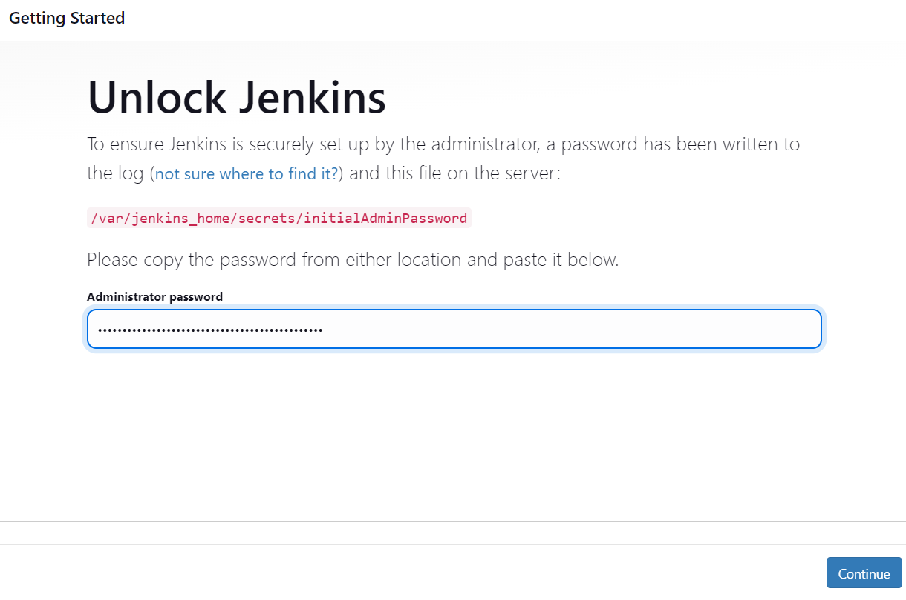
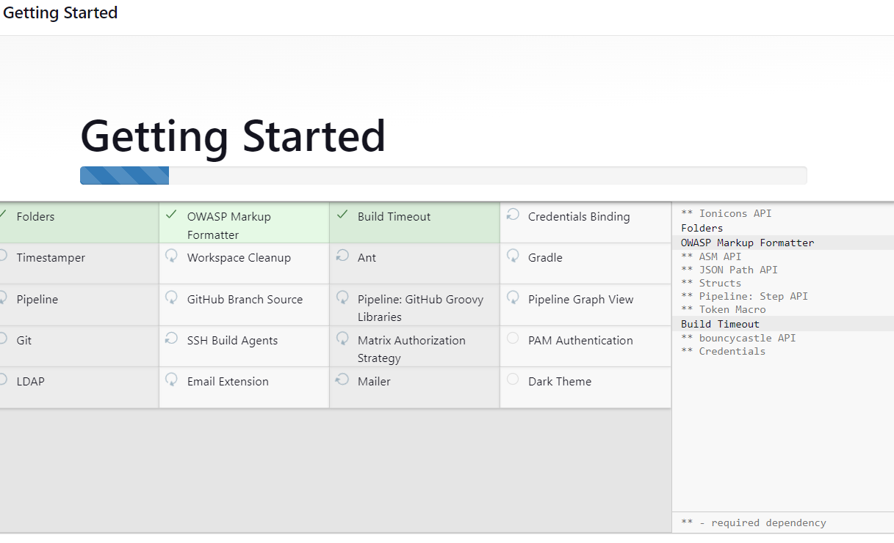
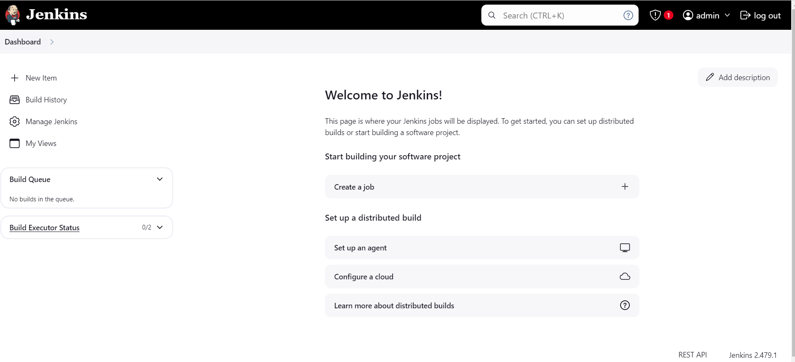
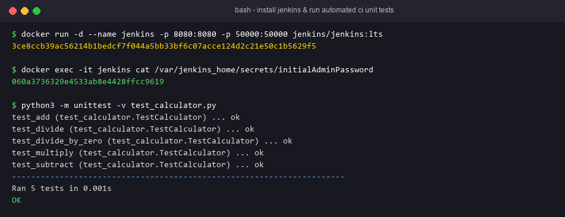

# Exercise 7 — Introduction to CI and Jenkins Installation

## Objective
Install Jenkins with Docker, unlock it with the initial admin password, and show the CI loop from the lab sheet on a small Python project: code change → automated build → automated test → feedback.

## Technologies
Docker, Jenkins LTS, Python 3 `unittest`.

## Project Structure
| File | Purpose |
|---|---|
| `install-jenkins.sh` | `docker run -d --name jenkins -p 8080:8080 -p 50000:50000 -v jenkins_home:/var/jenkins_home jenkins/jenkins:lts`, then prints `initialAdminPassword` |
| `ci-demo/calculator.py` | Code under CI |
| `ci-demo/test_calculator.py` | 5 unit tests |
| `ci-demo/Jenkinsfile` | Stages: Checkout → Build (`py_compile`) → Test (`unittest`), with post success/failure feedback |

The lab sheet covers only installation. `ci-demo` is a minimal, runnable example of its "CI Workflow Example" section. Exercises 8 and 9 build on this Jenkins instance.

## Prerequisites
Docker. To run `ci-demo` on Jenkins, the Jenkins agent also needs `python3`. For example: `docker exec -u root jenkins bash -c "apt-get update && apt-get install -y python3"`.

## Commands
```bash
docker run -d --name jenkins -p 8080:8080 -p 50000:50000 jenkins/jenkins:lts
docker ps -a
docker exec -it jenkins cat /var/jenkins_home/secrets/initialAdminPassword
# Open http://localhost:8080, paste the password, then Install suggested plugins and create the admin user
```
To run the CI demo on Jenkins: New Item → Pipeline → paste `ci-demo/Jenkinsfile`, or point "Pipeline script from SCM" at a repo containing `ci-demo/`.

## Testing
```bash
curl -I http://localhost:8080/login                         # HTTP 200
cd ci-demo && python3 -m py_compile calculator.py test_calculator.py && python3 -m unittest -v test_calculator.py
```
Failure path: change `return a + b` to `return a - b` and the Test stage fails. `sh` returns non-zero, so the pipeline result is FAILURE.

## Expected Output
Jenkins unlock page on :8080. The CI demo prints `Ran 5 tests ... OK` and ends `Finished: SUCCESS`.

## Actual Test Status
- Tested: `ci-demo` Build and Test commands ran locally and all 5 tests passed.
- Tested: a deliberately broken `calculator.py` made `unittest` exit 1 (`validate_failing_tests.sh`), so the Jenkins stage would fail.
- Tested: `install-jenkins.sh` passed `bash -n`.
- **Not run**: Jenkins itself. Docker and Java are not installed here, so no Jenkins console output is claimed.

## Troubleshooting
- `Conflict. The container name "/jenkins" is already in use`: run `docker start jenkins`, or `docker rm jenkins` first.
- `python3: not found` in a pipeline: install python3 in the Jenkins container (see Prerequisites).
- The password file is missing: Jenkins is still starting. Wait and retry.

## Architecture Diagram


## Process Screenshots
### Jenkins Initial Setup
| Unlock Jenkins | Customize Jenkins | Landing Page |
|---|---|---|
|  |  |  |

### Automated CI Pipeline Tests

