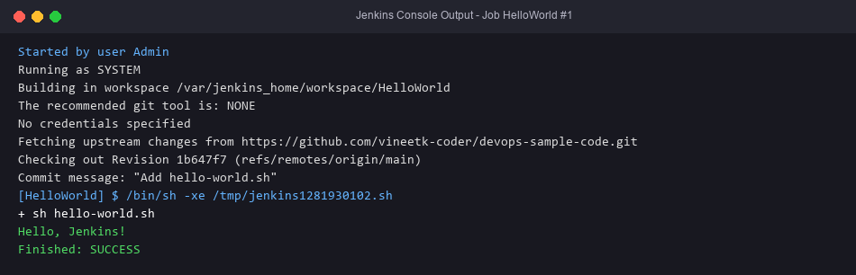

# Exercise 8 — "Hello World" Jenkins Job

## Objective
Create a Freestyle job `HelloWorld`. It checks out a Git repo containing `hello-world.sh` and runs it with an "Execute shell" build step.

## Technologies
Bash, Git, Jenkins Freestyle job.

## Project Structure
| File | Purpose |
|---|---|
| `hello-world.sh` | `#!/bin/bash` / `echo "Hello, Jenkins!"` |
| `job-config.xml` | Importable config for the Freestyle job: description "Hello World! Jenkins job.", Git SCM, shell step `sh hello-world.sh` |

## Prerequisites
Jenkins running (see Exercise 7) with the Git plugin. You also need a GitHub repo, e.g. `devops-sample-code`, that contains `hello-world.sh`.

> As requested, nothing was pushed to GitHub and no commits were made. You push the script to your own repo as described in the lab sheet.

## Commands
Your own repo (lab steps 1–7):
```bash
chmod +x hello-world.sh
git init && git add hello-world.sh && git commit -m "Add hello-world.sh"
git remote add origin https://github.com/<you>/devops-sample-code.git
git push -u origin main
```
Jenkins UI:
1. New Item → `HelloWorld` → Freestyle project.
2. Description: `Hello World! Jenkins job.`
3. Source Code Management → Git → `https://github.com/<you>/devops-sample-code.git`, branch `*/main`.
4. Build → Add build step → Execute shell → `sh hello-world.sh`.
5. Save → Build Now → #1 → Console Output.

Or import the job: edit the URL in `job-config.xml`, then:
```bash
java -jar jenkins-cli.jar -s http://localhost:8080/ -auth admin:<API_TOKEN> create-job HelloWorld < job-config.xml
```

## Testing
```bash
bash hello-world.sh        # Hello, Jenkins!
sh -xe hello-world.sh      # exactly how Jenkins' Execute shell runs it
```

## Expected Output
```
+ echo 'Hello, Jenkins!'
Hello, Jenkins!
Finished: SUCCESS
```

## Actual Test Status
- Tested (Git Bash): `sh -xe hello-world.sh` printed `+ echo 'Hello, Jenkins!'` and `Hello, Jenkins!` with exit code 0.
- Tested: `bash -n` syntax check passed.
- **Not run**: the Jenkins job, because Jenkins is not installed here. The GitHub push was deliberately not done.

## Troubleshooting
- `hello-world.sh: not found`: the SCM URL or branch is wrong (`main` vs `master`).
- `$'\r': command not found`: the file has Windows CRLF line endings. Run `dos2unix hello-world.sh` or set `git config core.autocrlf input`.

## Architecture Diagram


## Process Screenshots

