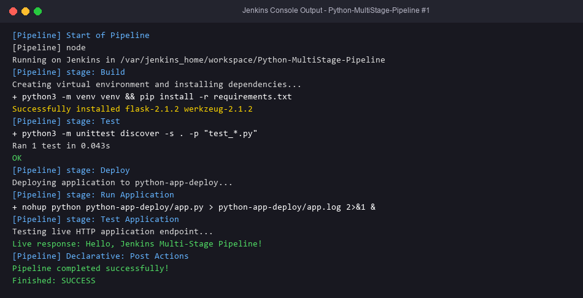

# Exercise 9 — Jenkins Multi-Stage Pipeline (Python Flask)

## Objective
Automate CI/CD for a Flask app with a declarative pipeline: **Build → Test → Deploy → Run Application → Test Application**, with post success/failure messages.

## Technologies
Python 3, Flask 2.1.2, unittest, venv, Jenkins Pipeline.

## Project Structure (`python-flask-app/`)
| File | Purpose |
|---|---|
| `app.py` | `GET /` → `Hello, Jenkins Multi-Stage Pipeline!` (port 5000, debug, reloader off) |
| `requirements.txt` | `flask==2.1.2`, `Werkzeug==2.1.2` |
| `test_app.py` | The unittest from the lab sheet |
| `Jenkinsfile` | The 5 stages |
| `simulate_pipeline.sh` | Runs the same stage commands locally without Jenkins |

### Stage behaviour
| Stage | What it does |
|---|---|
| Build | `python3 -m venv venv` and `pip install -r requirements.txt`. The lab's Expected Outcome says pip installs deps; its sample Jenkinsfile only echoed |
| Test | `python -m unittest discover`. A failure gives a non-zero exit, so the pipeline FAILS |
| Deploy | `mkdir -p $WORKSPACE/python-app-deploy`, then copy `app.py` into it |
| Run Application | `nohup` starts the deployed app in the background and writes `app.pid` |
| Test Application | Runs `test_app.py`, then sends an HTTP GET to the **live** server at `127.0.0.1:5000` and checks the body |

### Fixes to the reference
- `JENKINS_NODE_COOKIE=dontKillMe`: Jenkins kills background processes when an `sh` step ends, so without it the app would be dead before Test Application.
- `use_reloader=False`: the debug reloader forks a child process, so the saved PID would not be the server's.
- Werkzeug pinned: Flask 2.1.2 fails to import with Werkzeug 3.x.
- The lab's original Test Application stage only re-ran the test-client test. The added live HTTP check really verifies the deployed app.

## Prerequisites
Jenkins (Exercise 7) with the Pipeline plugin. The agent needs `python3` and `python3-venv`:
`docker exec -u root jenkins bash -c "apt-get update && apt-get install -y python3 python3-venv python3-pip"`

## Commands
Jenkins: New Item → `Python-MultiStage-Pipeline` → Pipeline. Then either choose "Pipeline script from SCM" (Git, your repo whose root contains these files) or paste the Jenkinsfile. Click Build Now.

Locally (Linux/macOS/WSL/Git Bash):
```bash
cd python-flask-app
bash simulate_pipeline.sh
python3 -m unittest discover -s .
```

## Testing
- Pipeline console shows every stage, `Ran 1 test ... OK`, `Live response: Hello, Jenkins Multi-Stage Pipeline!`, and `Finished: SUCCESS`.
- Negative test: change the return string in `app.py`. The Test stage fails, the post `failure` block runs, and the result is `Finished: FAILURE`.

## Expected Output
See the lab sheet's sample console. Ours also includes the venv/pip output and the live-response line.

## Actual Test Status
- Tested: `test_app.py` passed with the pinned Flask 2.1.2 and Werkzeug 2.1.2 (Python 3.10).
- Tested: `simulate_pipeline.sh` ran all five stages under Git Bash and exited 0. Build created the venv and installed deps; Test ran 1 test, OK; Deploy copied `app.py`; Run started the server; Test Application passed the unittest and the live HTTP response matched.
- Tested: a broken `app.py` made `unittest` exit 1, so the Test stage would fail the pipeline (`validate_failing_tests.sh`).
- **Not run**: Jenkins itself is not installed. The Jenkinsfile has been reviewed but not executed by Jenkins.

## Troubleshooting
- `python3: not found` or `ensurepip is not available`: install `python3-venv` in the Jenkins container.
- `ImportError: cannot import name 'url_quote' from 'werkzeug'`: Werkzeug is not pinned.
- Test Application cannot connect: port 5000 is busy (a previous run). The Run stage kills the old PID first.

## Architecture Diagram


## Process Screenshots

