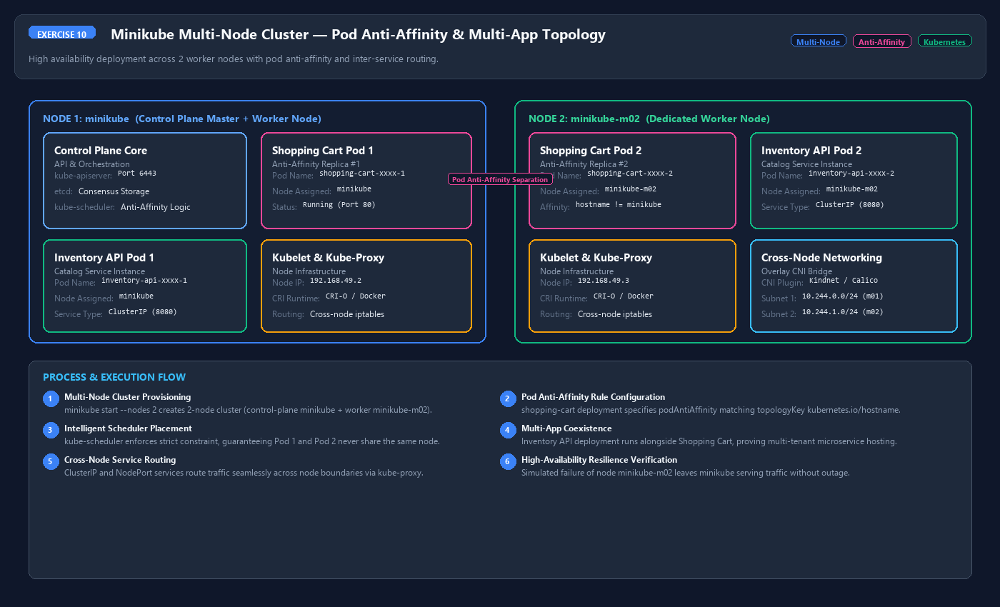
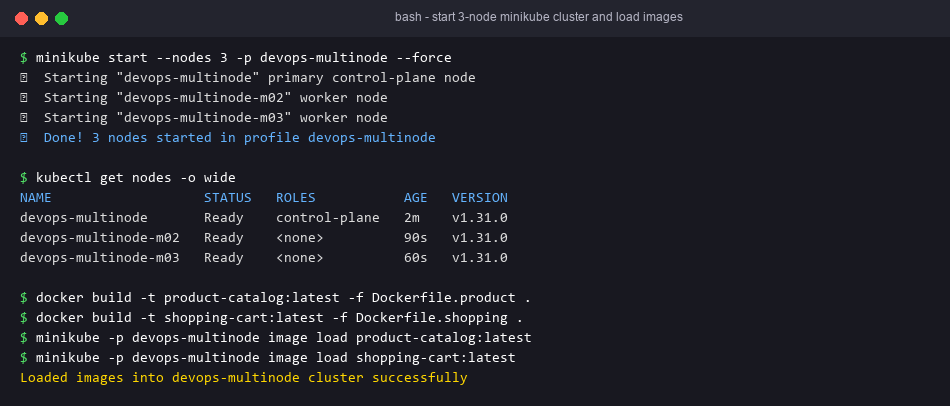
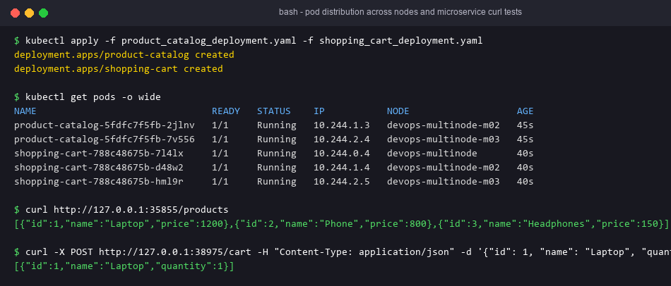

# Exercise 10 — Multi-Node Minikube Cluster with Multiple Applications

## Objective
Deploy two microservices on a 3-node Minikube cluster: Product Catalog with 2 replicas and Shopping Cart with 3 replicas. Required pod anti-affinity puts each replica of an app on a different node.

## Technologies
Python/Flask, Docker, Minikube (multi-node, profile `devops-multinode`), Deployments/ReplicaSets, NodePort Services, pod anti-affinity.

## Project Structure
| File | Purpose |
|---|---|
| `product_catalog.py` | `GET /products` returns 3 products (port 80) |
| `shopping_cart.py` | `GET /cart`, `POST /cart` (201) (port 80) |
| `Dockerfile.product`, `Dockerfile.shopping` | Images `product-catalog:latest`, `shopping-cart:latest` |
| `product_catalog_deployment.yaml` | Deployment `product-catalog`, replicas **2**, label `app=product-catalog`, anti-affinity on `kubernetes.io/hostname` |
| `shopping_cart_deployment.yaml` | Deployment `shopping-cart`, replicas **3**, label `app=shopping-cart`, anti-affinity |
| `product_catalog_service.yaml` | NodePort `product-catalog-service` 80→80 |
| `shopping_cart_service.yaml` | NodePort `shopping-cart-service` 80→80 |
| `run.sh` | Full run |

### Fix to the reference
The reference puts `shopping-cart` in namespace `devops-exercise`, which does not exist and is never created, while `shopping-cart-service` is in `default`. A Service only selects pods in its own namespace, so the apply would fail or the Service would have no endpoints. Both now use `default`.

## Prerequisites
Minikube with the Docker driver (or another driver), kubectl, and Docker. You need roughly 3 × 2 CPU / 2 GB RAM.

## Commands
```bash
minikube stop; minikube delete
minikube start --nodes 3 -p devops-multinode --force
minikube -p devops-multinode addons enable registry
docker build -t product-catalog:latest -f Dockerfile.product .
docker build -t shopping-cart:latest -f Dockerfile.shopping .
minikube -p devops-multinode image load product-catalog:latest
minikube -p devops-multinode image load shopping-cart:latest
kubectl apply -f product_catalog_deployment.yaml
kubectl apply -f shopping_cart_deployment.yaml
kubectl apply -f product_catalog_service.yaml
kubectl apply -f shopping_cart_service.yaml
```

## Testing
```bash
kubectl get nodes                       # devops-multinode, -m02, -m03 all Ready
kubectl get deployments                 # product-catalog 2/2, shopping-cart 3/3
kubectl get pods -o wide                # each app's replicas on distinct nodes
kubectl get svc                         # two NodePort services
kubectl get endpoints product-catalog-service shopping-cart-service   # 2 and 3 pod IPs
minikube -p devops-multinode service product-catalog-service --url
minikube -p devops-multinode service shopping-cart-service --url
curl <pc-url>/products
curl <sc-url>/cart
curl -X POST <sc-url>/cart -H "Content-Type: application/json" -d '{"id": 1, "name": "Laptop", "quantity": 1}'
```

## Expected Output
- 3 Ready nodes. 5 Running pods. No two pods of the same app share a node.
- `/products` returns the 3 products. `/cart` returns `[]`. POST returns 201 with the item.

The cart lives in each pod's memory, so successive GETs may hit different replicas and show different carts. That is expected for this stateless demo.

## Actual Test Status
- Tested: `GET /products`, `GET /cart` → `[]`, and `POST /cart` → 201 with the posted item (Flask test clients).
- Tested: all 4 manifests parsed. Replica counts are 2 and 3; selectors equal the template labels; each Service selects the right pods **in the same namespace**; targetPort 80 matches the container port.
- **Not run**: the multi-node cluster, the images and the pod distribution. Minikube and Docker are not installed here, so no node or pod listings are claimed.

## Troubleshooting
- A shopping-cart pod stays `Pending` with "didn't match pod anti-affinity rules": fewer than 3 nodes are Ready. Required anti-affinity needs one node per replica.
- `ErrImageNeverPull`: the image was not loaded on that node. Re-run `minikube -p devops-multinode image load ...`.
- kubectl points at the wrong cluster: `kubectl config use-context devops-multinode`.

## Architecture Diagram


## Process Screenshots



